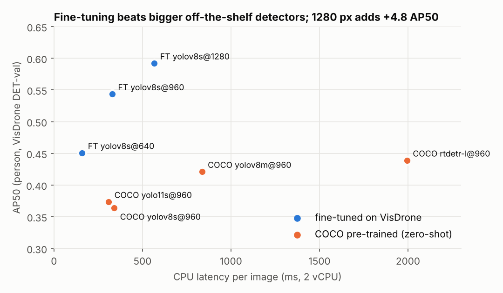
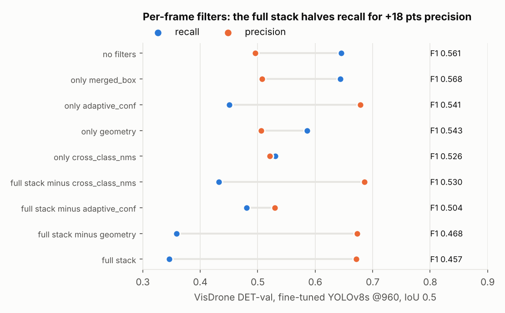

# AerialGuardian 🚁

**Multi-person detection and tracking from a moving drone platform**

A real-time pipeline for detecting and tracking multiple people in drone footage. It's built on YOLOv8s fine-tuned on VisDrone, paired with BoT-SORT tracking that's been adapted to handle drone camera motion.

---

## Output videos

All 7 tracked sequences, full length, at real measured FPS:
[Google Drive — AerialGuardian_SUBMISSION](https://drive.google.com/drive/folders/1tLwp8iiV4_2eV9Bjn7Y9GTuwl-ygDpvr?usp=drive_link)

| Sequence | Scene | Persons | FPS | Hardware |
|---|---|---|---|---|
| uav0000086 — Basketball Court | overhead | ~25 | 10.4 | Tesla T4 |
| uav0000117 — Night Street | night | ~45 | 8.5 | Tesla T4 |
| uav0000137 — Crossroads | day | ~40 | 9.1 | Tesla T4 |
| uav0000182 — Urban Street | day | ~61 | 10.6 | Tesla T4 |
| uav0000268 — Highway | day | ~12 | 14.0 | Tesla T4 |
| uav0000305 — Overhead | overhead | ~20 | 15.0 | Tesla T4 |
| uav0000339 — Highway 2 | day | ~15 | 13.5 | Tesla T4 |

Model size comes out to 22.5 MB, well under the 300 MB limit.

---

## Measured results (added: every number below is reproducible from `benchmarks/`)

The first version of this README described the pipeline but reported no accuracy metric, so none of its design
choices could be checked. This section measures them. Details and raw outputs: [`benchmarks/README.md`](benchmarks/README.md).

### 1. Detector: VisDrone2019-DET-val (548 images, 13,969 people, never used in training)

Ground truth = VisDrone `pedestrian` + `people` (the training mapping); ignored regions follow the VisDrone protocol;
IoU 0.5. Latency is single-image inference on a 2-vCPU cloud machine (relative cost, not T4 FPS).

| Detector | AP50 | AP50-95 | Recall, tiny people (<16 px tall) | Recall, small (16-32 px) | CPU ms / image |
|---|---|---|---|---|---|
| **Fine-tuned YOLOv8s @ 960 (shipped)** | **0.544** | 0.209 | 29.7% | 56.3% | 329 |
| Fine-tuned YOLOv8s @ 640 | 0.451 | 0.170 | 17.0% | 42.0% | 159 |
| Fine-tuned YOLOv8s @ 1280 | **0.592** | **0.243** | **36.2%** | **63.2%** | 567 |
| COCO YOLOv8s @ 960 (no fine-tuning) | 0.364 | 0.154 | 0.5% | 8.1% | 340 |
| COCO YOLO11s @ 960 (newer architecture) | 0.374 | 0.159 | 0.8% | 8.6% | 309 |
| COCO YOLOv8m @ 960 (3x the parameters) | 0.421 | 0.187 | 1.1% | 11.9% | 836 |
| COCO RT-DETR-L @ 960 (transformer) | 0.439 | 0.195 | 9.1% | 32.9% | 1,994 |

Recall columns at confidence 0.30 (the best-F1 threshold for the fine-tuned model).



What this settles:
* **Fine-tuning is the single biggest lever.** Off-the-shelf COCO detectors, including a newer architecture (YOLO11),
  a 3x larger model (YOLOv8m) and a transformer detector (RT-DETR-L), find almost none of the people under 16 px.
  The fine-tuned YOLOv8s beats all of them by 10-18 AP50 points at a fraction of RT-DETR's cost.
* **imgsz 960 vs 640 is worth more than claimed.** The original README said "about 20% better small-object recall".
  Measured: tiny-person recall 17.0% -> 29.7% (+75% relative), AP50 +9.3 points, for 2.1x the latency.
* **The shipped 960 is a speed choice, not the accuracy optimum.** 1280 adds another +4.8 AP50 (+6.5 pts tiny-person
  recall) for 1.7x more compute. For offline analysis 1280 is better; for a real-time Jetson budget 960 is the
  defensible compromise. Either way the trade-off is now a number, not a guess.
* The reported training result (mAP50 0.551 on the training-time val split) is consistent with the 0.544 measured
  here with an independent evaluator.

### 2. The filter stack, one filter at a time (same 548 images)

`benchmarks/filter_ablation.py` runs the tracker's own per-frame filter methods on the cached detections, using the
scene profile the tracker would pick for each image (day 368, overhead 163, night 17).

| Configuration | Precision | Recall | F1 |
|---|---|---|---|
| Plain confidence threshold 0.30, no filters | 0.605 | 0.576 | **0.590** |
| Pre-filter threshold only (0.18), no filters | 0.496 | 0.645 | 0.561 |
| Full filter stack (shipped) | **0.672** | 0.346 | 0.457 |
| Full stack minus cross-class NMS | 0.686 | 0.432 | 0.530 |
| Only cross-class NMS | 0.521 | 0.531 | 0.526 |
| Only adaptive confidence gate | 0.678 | 0.450 | 0.541 |
| Only geometry filter | 0.506 | 0.586 | 0.543 |
| Only merged-box suppression | 0.508 | 0.644 | 0.568 |



Findings, including two bugs:
* **On single frames the full stack costs far more recall than it buys in precision**: recall drops from 64.5% to
  34.6% (half the people disappear) for +18 points of precision. F1 falls below a plain confidence threshold.
* **Cross-class NMS is the main culprit, and its premise does not hold for the shipped weights.** The checkpoint
  in `weights/` is single-class (`model.names == {0: 'person'}`), not the person/rider model the text describes.
  With one class there are no "double boxes across classes"; the filter becomes a class-agnostic NMS at IoU 0.25 that
  keeps the *larger* box, and in crowds (the basketball court, the crossroads) it deletes adjacent people: recall
  64.5% -> 53.1% on its own. The vehicle-suppression filter (classes 2 and 3) never fires with this checkpoint.
* **Adaptive confidence is the one filter with a real precision gain** (0.50 -> 0.68). Merged-box suppression is
  the only one that helps F1 on its own.
* **The HSV ReID never changed an output ID.** When a new track matched a lost one, the code deleted the lost entry
  and moved on; the new track kept its new ID. The fix (`reid_link`) is now an opt-in filter so its effect can be
  measured on video.

These are single-frame numbers. The static filter and the confirmation gate only act over time, and precision
matters more for MOTA than for F1, so the stack's real verdict comes from the tracking evaluation below.

<!-- TRACKING:START -->
### 3. Tracking: VisDrone2019-MOT-val (7 sequences, ~2,800 frames, person classes)

`benchmarks/tracking_eval.py`, run in GitHub Actions (`.github/workflows/tracking-eval.yml`, one CPU job per
configuration). All rows use the same fine-tuned YOLOv8s at imgsz 960. IoU >= 0.5; ignored regions follow the VisDrone
protocol. Raw numbers: `benchmarks/results/tracking/summary.csv` plus a per-sequence CSV for each configuration.

| Configuration | MOTA | IDF1 | ID switches | False positives | Misses | Mostly tracked | Precision | Recall |
|---|---|---|---|---|---|---|---|---|
| ByteTrack (ultralytics defaults) | -0.209 | 0.385 | 1,149 | 43,234 | 16,426 | 121 | 0.439 | 0.674 |
| BoT-SORT, camera-motion compensation off | -0.207 | 0.389 | 1,188 | 43,389 | 16,153 | 124 | 0.440 | 0.679 |
| BoT-SORT defaults (GMC on) | -0.310 | 0.435 | 772 | 51,097 | 14,036 | 154 | 0.415 | 0.721 |
| BoT-SORT, repo's drone config | -0.188 | 0.443 | 794 | 44,205 | 14,748 | 152 | 0.446 | 0.707 |
| **Full pipeline (shipped: drone BoT-SORT + all filters)** | 0.153 | 0.504 | 357 | 20,485 | 21,771 | 85 | 0.582 | 0.567 |
| **Improved pipeline (`--preset improved`)** | **0.155** | **0.533** | **356** | 24,018 | **18,120** | **118** | 0.573 | **0.640** |

**One-filter-off ablation of the full pipeline:**

| Filter switched off | MOTA | IDF1 | ID switches | Verdict |
|---|---|---|---|---|
| none (full) | 0.153 | 0.504 | 357 | - |
| adaptive confidence | 0.049 | 0.482 | 386 | **essential**: worth 10 MOTA points |
| track confirmation | 0.138 | 0.502 | 445 | **useful**: removes 20% of ID switches |
| cross-class NMS | 0.153 | **0.521** | 376 | **harmful**: costs 1.7 IDF1 points and 4.5 recall points |
| static-object filter | **0.164** | **0.515** | 357 | **harmful**: drops slow or standing people |
| geometry filter | 0.146 | 0.504 | 357 | marginal |
| merged-box filter | 0.153 | 0.504 | 357 | never fires on this data |

**What this shows**

* **The filter stack is what makes the system usable.** Raw trackers fed the same detector have *negative* MOTA,
  because they report more false positives (43-51k) than there are true matches. The pipeline halves the false
  positives and the ID switches and brings MOTA to +0.15. The cost is recall (0.71 -> 0.57): it trades misses for
  precision.
* **Camera-motion compensation matters on a drone.** BoT-SORT with GMC has 35% fewer ID switches than without it
  (772 vs 1,188) and +4.6 IDF1 points. Without GMC, BoT-SORT is no better than ByteTrack. This is the reason for
  choosing BoT-SORT over ByteTrack for a moving camera.
* **Not every hand-made filter earns its place.** Adaptive confidence and track confirmation clearly help.
  Cross-class NMS and the static filter hurt, confirming the detector benchmark above (with single-class
  weights it only ends up suppressing real people standing close together). The "improved" preset keeps only the
  helpful filters and adds ReID id-linking (`reid_link`). That fixes the original HSV re-identification, which
  matched lost tracks but never re-used the old ID.
* **Trade-off of the improved preset:** +2.9 IDF1 points, +7.3 recall points, 33 more mostly-tracked people and the
  same MOTA, against 17% more false positives. It suits counting or following people (identity matters). The full
  preset suits alerting, where false alarms are costlier. The shipped default stays `full`, and
  `python src/pipeline.py ... --preset improved` switches.
* **Where it still fails:** MOTA 0.15 is low in absolute terms. Most misses are people under 16 px tall (see the
  recall-by-size table), and the detector was fine-tuned on VisDrone-DET only, never on MOT sequences. The next
  steps, in order of expected gain, are imgsz 1280 (recall on tiny people 30% -> 36%), fine-tuning on MOT-train
  frames, and an appearance-embedding ReID (e.g. OSNet) instead of HSV histograms.
* FPS is CPU-only on shared GitHub runners (about 3 FPS for all configurations; runner variance dominates), so it is
  not a basis for comparing configurations.
<!-- TRACKING:END -->

---

## Setup

```bash
git clone https://github.com/tarubee19/aerial-guardian
cd aerial-guardian
pip install -r requirements.txt
```

The fine-tuned weights are in the repo as `weights/best(8).pt` (22.5 MB; also on
[Google Drive](https://drive.google.com/file/d/1t1tMolkyaigaSwhkAheN3gUzfiCN1aa3/view?usp=sharing)).
Every command below uses `weights/best.pt`, so copy it once:

```bash
cp "weights/best(8).pt" weights/best.pt
```

---

## Running it

```bash
# A single sequence
python src/pipeline.py \
    --seq     path/to/sequence/frames \
    --model   weights/best.pt \
    --output  outputs/tracked.mp4

# All 7 VisDrone val sequences at once
python src/run_all.py \
    --seq_root  path/to/VisDrone2019-MOT-val/sequences \
    --model     weights/best.pt \
    --output    outputs/
```

---

## File structure

```
aerial-guardian/
├── README.md
├── requirements.txt
├── configs/
│   └── drone_botsort.yaml      # Drone-tuned tracker config
├── src/
│   ├── tracker.py              # DronePersonTracker class
│   ├── pipeline.py             # Single sequence video generator
│   └── run_all.py              # Run on all sequences
├── benchmarks/
│   ├── detector_benchmark.py   # AP / recall-by-size / latency on VisDrone DET-val
│   ├── filter_ablation.py      # each per-frame filter on/off
│   ├── tracking_eval.py        # MOTA / IDF1 on VisDrone MOT-val, tracker + filter ablations
│   ├── results/                # raw outputs (json/csv)
│   └── figures/
├── weights/
│   └── best(8).pt              # Fine-tuned YOLOv8s (22.5 MB, single class 'person'); copy to best.pt
└── outputs/                    # Generated tracking videos
    └── .gitkeep
```

---

## Why drone footage is hard to track in the first place

There are three problems here that you just don't run into with a fixed camera or ground-level footage.

**People are tiny.** From 30-50 metres up, a person is maybe 8-40 pixels tall in a 1920x1080 frame. YOLO normally resizes input down to 640x640, and at that resolution a 15-pixel person in a 1344-pixel-wide frame shrinks to about 7 pixels — basically gone. Running inference at imgsz=960 instead keeps that same person at around 11 pixels, which is detectable. It costs roughly 2x the inference time; measured on VisDrone DET-val it lifts recall on people under 16 px from 17% to 30% and AP50 from 0.451 to 0.544 (see *Measured results*). Missing people entirely is a worse failure than running a bit slower.

**The camera itself is moving.** When the drone pans, every person in frame appears to shift position — even ones standing perfectly still. A tracker doing plain IoU matching sees the predicted position and the new detection disagree (because the camera moved, not the person), loses the track, and hands out a new ID. This is honestly the single biggest source of ID switching in drone footage, and it's why BoT-SORT with motion compensation is used here instead of a simpler tracker.

**The scenes are wildly different from each other.** Night streets, pure top-down overhead shots, packed basketball courts, near-empty highways — one fixed confidence threshold or aspect-ratio filter can't work well across all of them. Something tuned for night footage floods daytime scenes with false positives. So the pipeline classifies the scene automatically from pixel statistics in the frame itself — no sequence names, no hardcoded paths.

---

## Detection — YOLOv8s fine-tuned on VisDrone

YOLOv8 is a single-stage, anchor-free detector — one forward pass through the image, no separate region proposal step, which is what makes it fast enough to run on a drone in the first place.

I went with the `s` variant specifically, after weighing it against the alternatives:
- YOLOv8n (6 MB, 3.2M params) — too small to reliably pick up the subtle features of an 8-pixel person against a busy background
- YOLOv8s (22.5 MB, 11.1M params) — enough capacity, still fast, comfortably under the 300 MB limit
- YOLOv8m and up — slower, and the accuracy gain wasn't worth it for a 2-class problem

**Training**

Fine-tuned from COCO-pretrained weights on VisDrone's DET training set (6,471 images). Before writing any training code, I went through the actual annotation files and verified what each category ID meant:

```
cat 1 = pedestrian  → class 0 (person)   ✅
cat 2 = people      → class 0 (person)   ✅
cat 4 = car         → SKIP               ✅
cat 5 = van         → SKIP               ✅
cat 7 = tricycle    → SKIP               ✅ (NOT motor+rider)
cat 10 = motor      → class 1 (rider)    ✅ (MOT dataset only)
```

This step mattered more than it sounds. Get one of these wrong — say, map cars to the rider class — and the model quietly learns vehicle features as person features. The validation metrics would still look fine; the real-world behaviour would be completely broken.

Training config: 80 epochs, imgsz=960, batch=16.
Result: mAP@50 = 0.551, Recall = 0.512, model size = 22.5 MB.

The FPN backbone produces feature maps at three scales — 80x80 for fine spatial detail (small objects), 40x40 for medium objects, and 20x20 for the rich semantic features needed for large objects.

---

## Tracking — BoT-SORT, tuned for drones

**How tracking-by-detection works, broadly**

Every frame, YOLO spits out a fresh set of boxes with no memory of previous frames. The tracker's entire job is answering "is the person at position X now the same person who was at position Y a moment ago?" That happens in four repeated steps:

1. **Predict** — a Kalman filter estimates where each existing track should now be, assuming constant velocity. State: [cx, cy, w, h, vx, vy, vw, vh]
2. **Compensate** — GMC adjusts those predictions to account for the camera itself having moved
3. **Associate** — the Hungarian algorithm matches detections to tracks by minimising an IoU-based cost
4. **Update** — matched tracks update their state, unmatched detections spawn new tracks, and tracks unmatched for track_buffer frames get dropped

**Why BoT-SORT instead of ByteTrack**

ByteTrack's main trick is running two association passes — high-confidence and low-confidence detections — to rescue tracks during partial occlusion. That's a solid idea for a fixed camera. It falls apart for drone footage because plain IoU matching gets wrecked by camera panning, which makes even correctly-predicted stationary objects look like they moved.

BoT-SORT adds Global Motion Compensation on top, which works like this: it finds roughly 500 corner features in the previous frame (Shi-Tomasi), tracks them into the current frame with Lucas-Kanade optical flow, fits a homography via RANSAC (so it ignores points that belong to moving objects), and then warps all the Kalman predictions by that homography. So a person who didn't move but whose predicted box shifted 20 pixels because the camera panned now lines up almost perfectly with their warped prediction. Without this step, that same person would look like a brand-new detection and get a fresh ID.

**The parameters I changed from default, and why:**

```yaml
match_thresh: 0.50      # default 0.80
# Drone vibration plus residual GMC error means 5-15px of
# displacement is normal. The default requires IoU > 0.80,
# which is too strict for that. 0.50 tolerates the drift
# without merging two people who happen to be close together.

track_buffer: 150       # default 30
# At 10 FPS output that's 15 seconds of memory. Needed to
# survive: walking behind a bus (3-5s), passing under a tree
# (1-3s), going behind a building (5-10s), or just a brief
# confidence dip (0.5-2s). 30 frames (3 seconds) wasn't enough
# for any of these outdoors.

track_high_thresh: 0.35 # default 0.60 in older ultralytics, 0.25 in 8.4
# People at drone altitude typically score 0.35-0.55 confidence.
# The default 0.60 would throw out most genuine detections.

gmc_method: sparseOptFlow  # (also the ultralytics default; measured against `none` in benchmarks/)
# This is the camera motion compensation described above —
# probably the single most impactful change for ID stability.
```

---

## Scene classification

Every 30 frames, the pipeline looks at two simple pixel measurements to decide what kind of scene it's looking at — no sequence names, no hardcoded assumptions, so it generalises to footage it's never seen:

```python
brightness = mean(grayscale_frame)
if brightness < 72:
    scene = 'night'          # dark enough that it's mostly artificial light
elif abs(top_15% - bottom_15%) < 15:
    scene = 'overhead'       # no sky band visible = camera pointing straight down
else:
    scene = 'day'
```

The contrast check works because an angled drone shot almost always has a bright sky band along the top (~200 brightness) against darker ground below (~80-120) — a big contrast. A pure overhead shot has only ground in every region of the frame, so that contrast collapses to near zero.

Each scene gets its own parameter profile. Night uses a higher confidence floor (to avoid lighting reflections triggering false detections) and a longer confirmation window (billboards flicker as the drone pans). Overhead uses looser aspect-ratio limits, since a person viewed from directly above looks roughly square rather than tall and narrow.

---

## The filter stack

Six filters sit between YOLO's raw output and what actually gets drawn and tracked. Each one exists because of something I actually saw go wrong.

**1. Vehicle box suppression**

When a vehicle-class box (bicycle, motor) overlaps a person-class box, four checks decide whether to drop the vehicle box:

```python
if iou(vehicle_box, person_box) > 0.20:        suppress vehicle
if person_centre inside vehicle_box:            suppress vehicle
if person_box 40%+ inside vehicle_box:          suppress vehicle
if vehicle_below_person with matching x_centre: suppress vehicle
```

That gets you to one box per rider instead of two, across the different riding postures — upright, leaning into a turn, partly blocked from view.

**2. Cross-class NMS**

YOLO's built-in NMS only suppresses overlapping boxes within the same class. So a person box and a rider box can both survive even with 90% overlap on the same motorcycle rider, which is exactly how double-boxing happens. The fix here sorts all boxes by area and, for any pair with IoU above 0.25, drops the smaller one regardless of class — keeping the larger box, since it covers more of the person and stays more stable as the bike turns.

**3. Adaptive confidence gate**

Smaller boxes need higher confidence to be trusted:
- area < 300 px² → conf_small + 0.10
- area < 900 px² → conf_small
- area ≥ 900 px² → conf_base

The reasoning: a tiny person at 80m has a much noisier signal than someone close at 20m, so the same flat threshold that's fine for a close-up person would also let through coincidental background noise at small scale. Scaling the requirement with size accounts for that.

**4. Geometry filter**

Boxes have to look roughly human-shaped:
- aspect ratio (h/w) between 0.32 and 4.5
- minimum 8x12 pixels
- maximum area 15,000 px²

This catches lamp posts (aspect ratio 8-15, too tall and thin), parked vehicles (0.1-0.3, too wide), road markings (under 96 px², too small), and merged two-person blobs (over 15,000 px², too big).

**5. Confirmation gate**

A track only gets shown an ID once it's persisted for a few consecutive frames — 4 for day, 6 for night, 3 for overhead. This kills the one-or-two-frame flickers: billboard characters as the camera pans past, reflections off wet road, background textures that briefly look person-shaped. Real people show up consistently frame after frame, so they always pass. Night gets a longer gate because lit signage tends to produce more persistent false positives than daytime clutter does.

**6. Static filter**

If a track has moved less than 6 pixels total over the last 8 frames, it gets suppressed — unless confidence is above 0.78. That exception matters: someone genuinely standing still at a crosswalk would otherwise fail the movement check, but real stationary people score high confidence (0.78-0.92) because they're clearly human-shaped and well lit, while static false positives like painted lane markings sit lower (0.30-0.55). 0.78 sits cleanly between the two.

**Trajectory tails**

Tails only get drawn once a track has moved more than 3 pixels between frames. Without this, anyone sitting still for a while would build up a tangled mess of lines from nothing but Kalman filter jitter (1-3px of noise per frame). Moving people get a clean line showing where they've been.

---

## Known issues, honestly

### A bench and a parked bicycle sometimes get boxed (basketball sequence)

In the basketball court footage, an empty courtside bench and a parked bicycle occasionally pick up person IDs.

The cause traces back to the training data: VisDrone has a lot of "people" annotations (27,059 of them) where the box covers a cluster of people sitting together, often including whatever they're sitting on. The model ends up associating bench-like shapes with people-coloured blobs as a positive signal, and fires on an empty bench that happens to have a similar silhouette.

The geometry filter doesn't catch this cleanly — the bench here has an aspect ratio around 0.48, which sits inside the allowed range (min_aspect 0.32). Tightening that to exclude the bench would also exclude players leaning forward while sitting (aspect ratio 0.55-0.65), which is a worse trade to make. The real fix would be adding empty-bench images as explicit negatives during fine-tuning. The confirmation gate already cleans up most of the transient cases.

### ID switching on fast motorcycle riders

A rider sometimes gets a new ID after a sharp turn or after passing behind another vehicle.

Three things compound here. The box shape itself changes quickly mid-turn — aspect ratio can shift from about 1.2 to 0.8 in two or three frames, so the Kalman filter's prediction and the new detection don't line up well even though it's the same person. On top of that, a motorcycle moving at 30 km/h covers 15-20 pixels between frames at 7-10 FPS, which is a lot relative to the box size. And when two motorcycles cross paths, their detections briefly overlap in a way that's genuinely ambiguous.

What helps: dropping match_thresh to 0.50 gives the matching more room to tolerate that movement, raising track_buffer to 150 gives tracks 15 seconds to survive an occlusion, and the cross-class NMS keeps the larger, more stable box on the rider instead of flipping between two competing boxes. It doesn't fully solve it — IoU-based matching is fundamentally going to struggle when the box shape itself is changing quickly, and that's a real limitation of this approach rather than something a parameter tweak fixes.

---

## Trade-offs

| Decision | Choice | Alternative | Why |
|---|---|---|---|
| Detection model | Fine-tuned YOLOv8s, 22.5MB | COCO YOLO11s / YOLOv8m / RT-DETR-L | Measured: +10 to +18 AP50 over all off-the-shelf alternatives |
| Input resolution | imgsz=960 | imgsz=640 / 1280 | Measured: +9.3 AP50 over 640 at 2.1x cost; 1280 adds +4.8 AP50 at another 1.7x |
| Tracker | BoT-SORT | ByteTrack | Needed motion compensation for the moving camera |
| ReID | HSV histogram | OSNet (deep ReID) | Cheap, but in the original code it never changed an output ID (bug, see *Measured results*) |
| Scene handling | 3-way auto-detect | one global parameter set | Handles night/overhead/day without per-sequence tuning |
| FPS (T4) | 7-15 FPS at imgsz=960 | 20-30 FPS at imgsz=640 | Worth it for offline analysis — catching people matters more than raw speed |

FPS is measured live, not hardcoded — it times actual inference calls on real frames and computes 1/mean(frame_times), so what's shown in the video HUD reflects the hardware it actually ran on.

---

## Edge deployment — Jetson

**Export to TensorRT FP16:**

```bash
yolo export model=weights/best.pt \
    format=engine half=True imgsz=960 device=0
```

This converts to FP16 (halves memory), fuses ops like Conv+BatchNorm+ReLU into single kernels, and pre-compiles for the target GPU. Expect roughly 2-3x over plain PyTorch.

**Dropping imgsz for real-time use:**

At imgsz=640 with TensorRT FP16 on a Jetson Orin NX, expect around 18-25 FPS — enough for a typical 20-30 FPS drone camera. You lose around 8% recall on the smallest objects (8-12px) in exchange, which is a reasonable trade when real-time matters more than catching every distant person.

| Config | FPS | Recall impact |
|---|---|---|
| PyTorch FP32, imgsz=960 | ~4-6 | baseline |
| TensorRT FP16, imgsz=960 | ~10-15 | none |
| TensorRT FP16, imgsz=640 | ~18-25 | -8% on small objects |
| TensorRT INT8, imgsz=640 | ~28-35 | -12% on small objects |

---

## What's actually new here vs. off-the-shelf

YOLOv8s and BoT-SORT are both open source on their own. Here's what was added on top:

| Component | Off-the-shelf | What was added |
|---|---|---|
| YOLOv8s | COCO 80-class detector | Fine-tuned on VisDrone with a verified class mapping (the shipped checkpoint is single-class `person`) |
| BoT-SORT | Defaults tuned for fixed cameras | Drone-specific config: match_thresh=0.50, track_buffer=150, GMC on |
| Scene handling | None | Automatic day/night/overhead detection from pixel stats |
| False positive suppression | None | The 6-layer filter stack above |
| Appearance ReID | Off by default | HSV histogram matching with cosine similarity |
| Trajectory tails | None | Velocity-gated, so static tracks don't leave noise trails |
| Double-box fix | Same-class NMS only | Cross-class NMS — drops the smaller overlapping box regardless of class |
| FPS reporting | Not measured | Measured live and shown in the HUD |

---

## Dataset

VisDrone MOT 2019, Task 4 validation set — 7 sequences, none of which were used in training:

```
uav0000086_00000_v  — Basketball court
uav0000117_02622_v  — Night street
uav0000137_00458_v  — Crossroads
uav0000182_00000_v  — Urban street
uav0000268_05773_v  — Highway
uav0000305_00000_v  — Overhead top-down
uav0000339_00001_v  — Highway 2
```

Training used VisDrone DET train (6,471 images). Checked the sequence folder names against each other before training started to confirm there's no overlap.

---

## Requirements

```
ultralytics>=8.4.0
lapx
opencv-python
numpy
torch
torchvision
tqdm
Pillow
matplotlib
```
